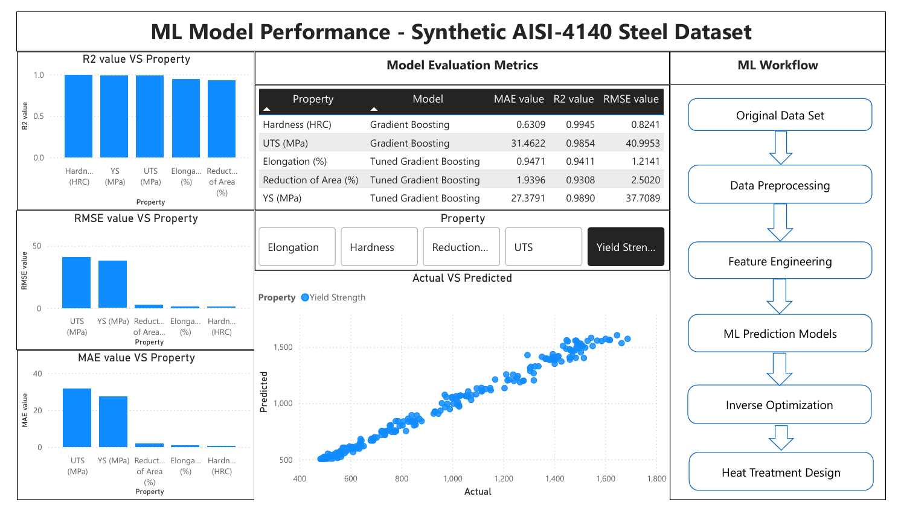

# Machine Learning-Based Inverse Heat Treatment Design for AISI 4140 Steel

An integrated **Machine Learning + Metallurgical Engineering + Power BI** project that uses inverse optimization to identify suitable heat-treatment parameters for AISI 4140 steel based on desired mechanical properties.

## Project Overview

Heat treatment parameters such as austenitizing temperature, quenching medium, tempering temperature and tempering duration strongly influence the mechanical properties of steel.

This project explores an inverse-design approach: users specify the desired mechanical properties, and the system uses trained machine-learning regression models with gradient-descent-based optimization to identify candidate heat-treatment process parameters. The optimized parameters are then used to generate a temperature–time process cycle, visualized in Power BI.

The modelling dataset is synthetic; predictions and optimized process conditions should therefore be treated as exploratory results requiring experimental validation before industrial use.

## Project Objectives

- Develop regression models linking heat-treatment conditions to mechanical properties.
- Use inverse optimization to search for process parameters that match user-defined property targets.
- Apply gradient descent to iteratively update continuous process variables.
- Generate and visualize a candidate heat-treatment process cycle.
- Integrate Python-based modelling with an interactive Power BI dashboard.

## Input and Output Parameters

**User-defined targets**
- Hardness (HRC)
- Ultimate tensile strength (MPa)
- Yield strength (MPa)
- Elongation (%)
- Reduction of area (%)
- Section thickness (mm)

**Optimized process parameters**
- Austenitizing temperature (°C)
- Quenching medium (air, oil or water)
- Tempering temperature (°C)
- Tempering time (hours)

## Methodology

1. Prepare and preprocess the synthetic heat-treatment dataset.
2. Train regression models to predict mechanical properties from process parameters.
3. Evaluate the models using MAE, RMSE and R².
4. Accept the user's target mechanical properties.
5. Use the trained prediction models within an inverse optimization loop.
6. Apply gradient descent to update the process variables and reduce the difference between target and predicted properties.
7. Use the optimized parameters to construct a heat-treatment temperature–time cycle.
8. Display the results in Power BI.

## Project Workflow

The project follows a two-stage workflow: first, predictive models are trained to learn the relationship between heat-treatment conditions and mechanical properties; then, those models are used in an inverse optimization loop to search for process conditions that match user-defined property targets.

```text
             Synthetic Dataset
                    |
                    v
          Data Preprocessing
                    |
                    v
           Feature Engineering
                    |
                    v
       Train Regression Models
                    |
                    v
          Model Evaluation
          (MAE, RMSE, R²)
                    |
                    v
       User-Defined Target Properties
                    |
                    v
        Inverse Optimization Loop
             (Gradient Descent)
                    |
                    v
       Optimized Process Parameters
                    |
                    v
       Heat-Treatment Cycle Generation
                    |
                    v
          Power BI Visualization
```

## Power BI Dashboards

### 1. Inverse Heat Treatment Process Cycle Dashboard

The dashboard displays the target mechanical properties, selected quenching medium, optimized process parameters, generated temperature–time cycle and target-versus-predicted property comparison.


### 2. Machine Learning Model Performance Dashboard

The model-performance dashboard presents R², MAE and RMSE comparisons, model evaluation metrics, actual-versus-predicted plots and the overall machine-learning-to-inverse-optimization workflow.



## Model Performance

The project evaluates five property-specific regression models.

| Property | Model | MAE | RMSE | R² |
|---|---|---:|---:|---:|
| Hardness (HRC) | Gradient Boosting | 0.6309 | 0.8241 | 0.9945 |
| UTS (MPa) | Gradient Boosting | 31.4622 | 40.9953 | 0.9854 |
| Elongation (%) | Tuned Gradient Boosting | 0.9471 | 1.2141 | 0.9411 |
| Reduction of Area (%) | Tuned Gradient Boosting | 1.9396 | 2.5020 | 0.9308 |
| Yield Strength (MPa) | Tuned Gradient Boosting | 27.3791 | 37.7089 | 0.9890 |

*Metrics are measured on the project's synthetic dataset and should not be interpreted as expected performance on real industrial data.*

## Example Inverse Design Result

One illustrative dashboard configuration uses the following targets:

| Target property | Value |
|---|---:|
| Elongation | 12% |
| Hardness | 40 HRC |
| Section thickness | 50 mm |
| Reduction of area | 35% |
| UTS | 1300 MPa |
| Yield strength | 1100 MPa |

The dashboard displays the following optimized process parameters for this example:

| Process parameter | Result |
|---|---:|
| Austenitizing temperature | 828.07 °C |
| Tempering temperature | 350.87 °C |
| Tempering time | 1.50 hours |
| Quenching medium | Water |

These are model-generated example outputs, not experimentally validated production recommendations.

## Technology Stack

- **Programming:** Python
- **Data processing:** NumPy, Pandas
- **Machine learning:** Scikit-learn
- **Optimization:** Gradient descent
- **Visualization:** Matplotlib, Microsoft Power BI
- **Data transformation:** Power Query

## Limitations and Future Work

- The current dataset is synthetic and requires replacement or supplementation with experimental and industrial data.
- High test performance on synthetic data does not establish generalization to real AISI 4140 components.
- Optimized process conditions need to be checked against metallurgical constraints, transformation behaviour, section size and applicable heat-treatment standards.
- Future work can incorporate physics-informed constraints, microstructural descriptors and experimental validation.

## Author

**Devashish Prasad**  
Metallurgical Engineering | Machine Learning | Computational Materials Science

[GitHub Profile](https://github.com/py-coder-deva)
